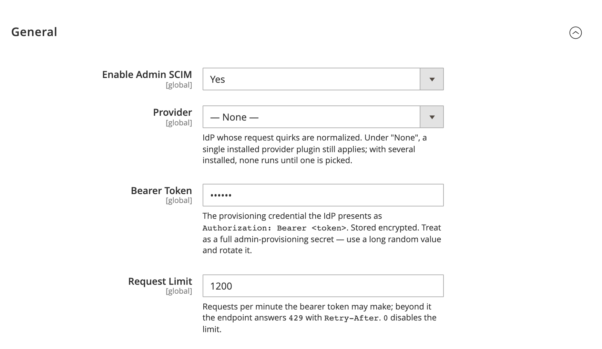

# DmLab_AdminScim

> SCIM 2.0 provisioning server for Magento 2 admin users.

[](https://github.com/dmlab-work/module-admin-scim/actions/workflows/ci.yml) [](https://codecov.io/gh/dmlab-work/module-admin-scim) [](https://packagist.org/packages/dmlab/module-admin-scim) [](https://packagist.org/packages/dmlab/module-admin-scim) [](https://packagist.org/packages/dmlab/module-admin-scim) [](LICENSE) 

Automatic admin offboarding. When IT removes a user in Okta or Entra, the Magento admin account is deactivated within minutes, and new hires get the right role before they log in. Access-control evidence for SOC 2 / ISO 27001.



## Install

```bash
composer require dmlab/module-admin-scim
bin/magento module:enable DmLab_AdminScim
bin/magento setup:upgrade
```

Using Okta or Entra? Install its provider plugin instead (`dmlab/module-admin-scim-okta` or `-azure`) — the single package that pulls this core.

## Requirements

- Magento 2.4.7+ · PHP 8.2–8.5
- HTTPS — the bearer token travels in the `Authorization` header

Pairs with [dmlab/module-admin-sso](https://github.com/dmlab-work/module-admin-sso) for SSO login; this module adds background provisioning and deprovisioning.

## Setup

1. In the admin panel go to **Stores → Configuration → DMLab → Admin SCIM**.
2. **Enable Admin SCIM** = *Yes*. The endpoint is disabled by default.
3. **Provider** — the IdP whose request quirks are normalized. Under *None* a
   single installed provider plugin still applies; with several, none runs until
   one is picked.
4. **Bearer Token** — set a long random value. It is stored encrypted and is the
   credential the IdP presents. Point your IdP's SCIM app at
   `https://<your-store>/admin-scim/v2` and configure it to send `Authorization: Bearer <token>`.
5. **Request Limit** — requests per minute the token may make (default `1200`);
   beyond it `429` with `Retry-After`. `0` disables it.
6. **Group → Role Map** — one `displayName=role_id` per line, mapping a SCIM group
   to a Magento admin role id (`#` lines ignored). A provisioned member gets the
   first matching role (admins hold a single role). `displayName` is not unique: a
   rule applies to every group with that name.
7. **Default Role Id** — role assigned when an admin's groups match no rule,
   including admins created with no groups (applied at user create/update). Leave
   empty to deny (no role).

## Scope

SCIM operates only on admins it created (`admin_user.dmlab_scim_managed = 1`).
A one-time data patch at install also flags admins that already carry an `externalId` or
a SCIM group membership — check that no local admin got flagged that way.

- Local admins are never visible to GET/list, never changed by PUT/PATCH/DELETE,
  never accepted as group members and never touched by group→role sync.
- Creating a user whose `userName` belongs to a local admin returns `409` — no
  adoption.
- A deactivate, delete or role strip that would leave no active admin holding a
  role is refused with `400 mutability`.
- `userName` (up to 255 chars) is stored and returned as sent. The admin login is the
  same value, or for one over 40 chars a prefix plus a hash suffix.

## Supported features

Advertised honestly in `ServiceProviderConfig`:

| Feature | Supported |
|---|---|
| PATCH | ✅ |
| Filter (`eq ne co sw ew gt ge lt le pr`, `and` `or` `not`, value paths) | ✅ (max 200 results) |
| Pagination (`startIndex`, `count`) | ✅ |
| `attributes` / `excludedAttributes` | ✅ |
| Bulk | ❌ |
| Sort | ❌ |
| ETag | ❌ |
| Change password | ❌ |
| Auth scheme | OAuth Bearer Token (RFC 6750) |

## Security notes

- The bearer token is a full admin-provisioning credential. It is stored encrypted
  (Magento `Encrypted` backend model) and compared as SHA-256 digests in constant time.
- Rotate the token by setting a new value; the old value stops working immediately.
- The endpoint is **disabled by default** and every request must authenticate —
  there is no anonymous read path.
- Auth failures return generic `401` messages that never reveal whether a token is
  configured. Unexpected errors are logged server-side and returned as a `500` with
  no internals leaked.
- `active=false` deprovisions an admin account, so treat the token with the same
  care as an admin password.
- The token is marked sensitive, so `app:config:dump` never writes it to
  `app/etc/config.php`.
- Failed-auth throttling: 10 failures per client IP, each within 15 min of the last → `429` with
  `Retry-After`. The client IP is `REMOTE_ADDR`; `X-Forwarded-For` is ignored. Behind a
  reverse proxy, list its IPs in the `trustedProxies` argument of
  `DmLab\AdminScim\Model\Auth\ClientIp` in `di.xml`, otherwise every client shares the
  proxy IP.
- Audit log: SCIM writes, role changes and auth failures (with client IP; never the
  token, headers or body) go to `var/log/dmlab_admin_scim_audit.log`.

## Architecture

Magento is a SCIM 2.0 (RFC 7643/7644) **server**; the IdP is the client and pushes
Users and Groups (→ ACL roles) to it. JIT provisioning in SSO acts only at login; SCIM
also deprovisions. Scope is admin users only; customer provisioning is out of scope.

### Endpoints

All endpoints live under the `admin-scim/v2` route area, derived from the store base URL:

```
https://<your-store>/admin-scim/v2
```

| Method | Path | Purpose |
|---|---|---|
| GET | `/ServiceProviderConfig` | Advertised capabilities |
| GET | `/ResourceTypes` · `/ResourceTypes/{id}` | All resource types · one (`404` if unknown) |
| GET | `/Schemas` · `/Schemas/{id}` | All schema definitions · one by URN (`404` if unknown) |
| POST | `/Users` | Create an admin user (`201` + `Location`) |
| GET | `/Users/{id}` · `/Users?filter=…` | Read one · list with filter + pagination |
| POST | `/Users/.search` | List via a SearchRequest body |
| PUT | `/Users/{id}` | Replace the whole resource |
| PATCH | `/Users/{id}` | Add/replace/remove attrs; `active=false` deprovisions, ends open admin sessions and revokes API tokens |
| DELETE | `/Users/{id}` | Hard delete (`204`) |
| POST | `/Groups` | Create a group (`201` + `Location`) |
| GET | `/Groups/{id}` · `/Groups?filter=…` | Read one · list with filter + pagination |
| POST | `/Groups/.search` | List via a SearchRequest body |
| PUT | `/Groups/{id}` | Replace name, externalId and members |
| PATCH | `/Groups/{id}` | Attribute + member add/replace/remove |
| DELETE | `/Groups/{id}` | Delete (`204`); former members' roles re-derived |

Other verbs (e.g. `HEAD`, `OPTIONS`) and `/Me`, `/Bulk`, root `/.search` answer
`501 Not Implemented`; unknown paths a SCIM `404`; `401` carries `WWW-Authenticate: Bearer`.
Errors use the RFC 7644 error schema (`urn:ietf:params:scim:api:messages:2.0:Error`)
with the correct status. Resources carry `meta.created` / `meta.lastModified`;
`externalId` and `displayName` over 255 chars are `400 invalidValue`.

### Filterable attributes

Users: `id`, `userName`, `externalId`, `emails[.value]`,
`name.givenName`, `name.familyName`, `active`, `meta.created`, `meta.lastModified`.
Groups: `id`, `displayName`, `externalId`, `members[.value]` (`eq`/`ne`/`pr`),
`meta.created`, `meta.lastModified`. String matching is case-insensitive except
`externalId`; others are `400 invalidFilter`.

### Provider quirks

The core accepts common IdP PATCH forms: URN-prefixed paths,
`emails[type eq "work"].value` / `emails[primary eq true].value`, stringified
booleans. Attributes `admin_user` can't store (e.g. `title`, `phoneNumbers`, the
enterprise extension) are ignored, not rejected; removing `userName`, `name.*`,
`emails` or `active` is `400 mutability`. IdP-specific shapes (e.g. Entra's flat
complex attrs) are absorbed by a per-IdP plugin via a normalization seam:

- The plugin implements `DmLab\AdminScim\Api\RequestNormalizerInterface` —
  a pure, total `normalize(resourceType, operation, payload)` that rewrites the
  decoded body toward RFC shape and returns it unchanged when nothing needs rewriting.
- It `di`-merges the normalizer into `RequestNormalizerChain` (see `etc/di.xml`)
  under its provider code (`okta`, `azure`, …). Before every create/replace/patch
  the chain runs **only the active provider's** normalizer (the **Provider** config
  field). With no plugin installed bodies pass through untouched.

## License

[OSL-3.0](LICENSE) © DMLab. Commercial licensing and support: <https://dmlab.work>.
